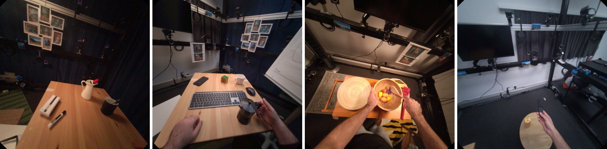
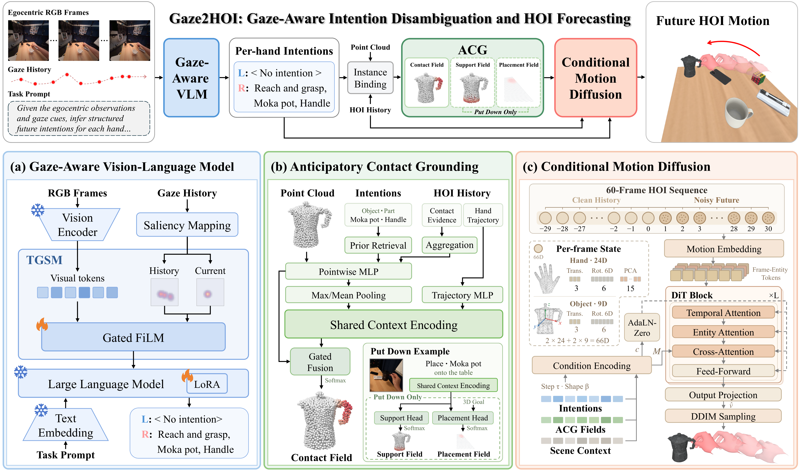

<h1 align="center">
  
  Gaze2HOI: Gaze-Aware Intention Disambiguation for<br>
  Egocentric Hand-Object Interaction Forecasting
</h1>

<p align="center">
  Chuanyang Ma, Chenye Wang, Yixuan Wang, Huiling Zhou, Xingqun Qi,<br>
  Muyi Sun, Man Zhang, Caifeng Shan, Zhenan Sun
</p>

<p align="center">
  <a href="https://arxiv.org/abs/2610.27877"></a>
  <a href="https://gaze2hoi.github.io/"></a>
  <a href="https://huggingface.co/gaze2hoi/Gaze2HOI"></a>
  <a href="https://huggingface.co/datasets/gaze2hoi/EgoAIM-Demo"></a>
</p>

<p align="center">
  <br>
  <sup><sup>
    <a href="https://gaze2hoi.github.io/#demo">
      
    </a>
  </sup></sup>
</p>

## 🔎 Overview

**Gaze2HOI** resolves intention ambiguity through gaze to forecast egocentric hand-object interactions. The framework connects three stages to predict articulated motion of both hands and 6-DoF object trajectories:

- **Gaze-aware intention inference.** Temporal Gaze Saliency Modulation (TGSM) integrates gaze history into a vision-language model to infer structured intentions for each hand.
- **Anticipatory contact grounding.** ACG translates intentions and observed interactions into contact fields, with support and placement fields for Put Down.
- **Coupled motion generation.** Conditional diffusion jointly forecasts hand and object motion under semantic and geometric conditions.

<details>
<summary><strong>Explore the framework</strong></summary>

<p align="center">
  <a href="docs/assets/architecture.webp"></a>
</p>

</details>

This inference release supports both standalone intention inference and the full forecasting pipeline. EgoAIM-Demo provides inputs and references for the project-page examples.

> **Inputs.** Full forecasting uses RGB observations, gaze, observed 3D hand and object states, camera geometry, and scene information. These inputs are included in the demo package. Training, third-party baselines, and reconstruction of these inputs from arbitrary videos are outside this release.

<a id="installation"></a>

## ⚙️ Installation

- **Environment:** Linux, Python 3.10, PyTorch 2.10.0, and CUDA 12.8 were used for verification.
- **GPU memory:** the BF16 intention base weights occupy approximately 16.3 GiB; allow additional memory for visual tokens and generation. Multi-GPU placement is supported.
- **Rendering:** FFmpeg and working OpenGL/EGL support. The default renderer uses EGL on NVIDIA GPUs.

```bash
git clone https://github.com/gaze2hoi/Gaze2HOI.git gaze2hoi-release
cd gaze2hoi-release

python3.10 -m venv .venv
source .venv/bin/activate
python -m pip install --upgrade pip setuptools wheel
python -m pip install torch==2.10.0 torchvision==0.25.0 \
  --index-url https://download.pytorch.org/whl/cu128
python -m pip install -e ".[intention,render,download]"
```

On Ubuntu, install FFmpeg with `sudo apt-get install ffmpeg`. For other CUDA environments, use a compatible [PyTorch installation](https://pytorch.org/get-started/locally/). See the [inference guide](docs/inference.md) for GPU placement and offline loading.

## 📦 Model and Data

| Resource | Contents | Download |
| :--- | :--- | :--- |
| **Gaze2HOI** | Intention adapter, contact and motion models, fixed assets | [Model weights](https://huggingface.co/gaze2hoi/Gaze2HOI) |
| **EgoAIM-Demo** | Inputs and references for the project-page examples | [Demo data](https://huggingface.co/datasets/gaze2hoi/EgoAIM-Demo) |

### Download the release assets

From the code checkout, run:

```bash
gaze2hoi download \
  --model-repo gaze2hoi/Gaze2HOI \
  --data-repo gaze2hoi/EgoAIM-Demo
```

The [Qwen3-VL-8B-Instruct](https://huggingface.co/Qwen/Qwen3-VL-8B-Instruct) base model is downloaded separately on first intention inference. MANO requires the local preparation below.

<details>
<summary><strong>Directory layout and custom paths</strong></summary>

The model and demo packages are saved next to the code checkout:

```text
workspace/
├── gaze2hoi-release/         # Code
├── gaze2hoi-checkpoints/     # Model weights and fixed assets
├── egoaim-demo/              # Example inputs and references
└── mano/                     # Locally prepared MANO files
```

Use `--checkpoints` and `--data` to override the asset locations, and pass the same paths to subsequent commands. See [asset setup](docs/assets.md) for package contents and pinned revisions.

</details>

### Prepare MANO

Obtain `MANO_LEFT.pkl` and `MANO_RIGHT.pkl` from the [official MANO website](https://mano.is.tuebingen.mpg.de/) under its license, then convert them to NumPy-only pickles:

```bash
python -m pip install --no-build-isolation chumpy==0.70
python tools/prepare_mano.py --source /path/to/original/mano --output ../mano
```

The conversion preserves numerical values and leaves the originals unchanged. MANO files are kept local and are not distributed with this project.

## 🚀 Quick Start

Run the **examples shown above** with `--samples overview`: Establish Contact, Move, Manipulate, and Put Down. Use CUDA to reproduce their recorded noise streams. Run all commands from the code checkout after completing the setup.

### 1. Verify the assets

```bash
gaze2hoi list --samples overview
gaze2hoi check --samples all --mano-dir ../mano --hashes
```

### 2. Forecast the interactions

A single command runs intention inference, contact grounding, and motion generation:

```bash
gaze2hoi forecast --samples overview --mano-dir ../mano \
  --output outputs/overview
```

### 3. Render and explore

```bash
gaze2hoi render --samples overview --mano-dir ../mano \
  --results outputs/overview --output outputs/gallery
python -m http.server 8000 --directory outputs/gallery
```

Open **[localhost:8000](http://localhost:8000/)** to compare observations, ground truth, and fresh forecasts in the local gallery. To run all supplied examples, replace `--samples overview` with `--samples all` in both `forecast` and `render`, using a new output directory.

<details>
<summary><strong>Run intention inference on its own</strong></summary>

Generate structured intentions without forecasting motion:

```bash
gaze2hoi intention --samples overview --output outputs/intentions
```

This writes a per-example `intention.json` and a combined `predictions.jsonl` using grammar-constrained decoding with `do_sample=False`. To reuse those intentions:

```bash
gaze2hoi forecast --samples overview --mano-dir ../mano \
  --intention-file outputs/intentions/predictions.jsonl \
  --output outputs/from-intentions
```

This step is optional: `forecast` already runs intention inference when no intention file is supplied. Run metadata records the source of the intentions.

</details>

## 📖 Documentation and Reproducibility

The default configuration retains 50 DDIM steps, guidance 1.5, eta 0, base seed 999, and each example's recorded draw. Forecasts are generated from observed inputs and rendered without temporal smoothing or motion refinement.

The supplied examples were checked in a matched environment. Hardware, kernels, precision, and software versions can affect numerical results; detailed measurements and limitations are documented below.

| Guide | What you will find |
| :--- | :--- |
| [Inference](docs/inference.md) | Sample selection, GPU placement, sampling controls, and outputs |
| [Asset setup](docs/assets.md) | Package contents, download revisions, and custom paths |
| [Data format](docs/data-format.md) | Input layout, coordinates, array shapes, and prediction files |
| [Reproduction checks](docs/reproducibility.md) | Numerical agreement, environment, resource use, and limitations |

### Repository structure

```text
gaze2hoi-release/
├── src/gaze2hoi/
│   ├── cli.py                # Command-line interface
│   ├── data.py               # Demo loading and validation
│   ├── io.py                 # File I/O and integrity checks
│   ├── intention/            # Gaze-aware intention inference
│   ├── motion/               # Contact grounding and motion generation
│   └── visualization/        # Trajectory rendering and video export
├── tests/                    # Input and inference checks
├── tools/prepare_mano.py     # Local MANO conversion
└── docs/                     # Usage and reproduction guides
```

## 📝 Citation

If you find this work helpful, please consider citing our paper:

```bibtex
@article{ma2026gaze2hoi,
    title   = {{Gaze2HOI}: Gaze-Aware Intention Disambiguation for Egocentric Hand-Object Interaction Forecasting},
    author  = {Ma, Chuanyang and Wang, Chenye and Wang, Yixuan and Zhou, Huiling and Qi, Xingqun and Sun, Muyi and Zhang, Man and Shan, Caifeng and Sun, Zhenan},
    journal = {arXiv preprint arXiv:2610.27877},
    year    = {2026}
}
```

## 🤝 Acknowledgments and Licenses

Gaze2HOI builds on [Qwen3-VL](https://github.com/QwenLM/Qwen3-VL), [HOT3D](https://github.com/facebookresearch/hot3d), [MANO](https://mano.is.tuebingen.mpg.de/), and the open-source libraries listed in [pyproject.toml](pyproject.toml). We thank their authors and contributors.

Repository code is released under the [MIT license](LICENSE). Model weights, datasets, MANO, and third-party assets retain their separate terms; see [NOTICE](NOTICE) and the notices in each package. HOT3D sequence data, hand annotations, and object models have distinct license terms.
