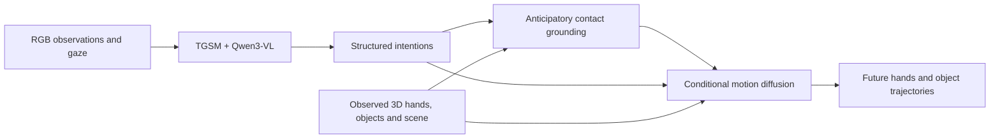

# Gaze2HOI

**Gaze-Aware Intention Disambiguation for Egocentric Hand-Object Interaction Forecasting**

[Project page](https://gaze2hoi.github.io/) · [Paper (PDF)](https://gaze2hoi.github.io/assets/documents/gaze2hoi-paper.pdf) · [Code](https://github.com/gaze2hoi/Gaze2HOI) · [Models](https://huggingface.co/gaze2hoi/Gaze2HOI) · [Examples](https://huggingface.co/datasets/gaze2hoi/EgoAIM-Demo) · [Quick start](#quick-start) · [Reproducibility](docs/reproducibility.md)

Gaze2HOI connects gaze-aware intention inference, anticipatory contact grounding, and coupled hand-object motion generation. Given an observation window, it predicts structured intentions for both hands and forecasts articulated hand motion together with object trajectories.

This repository provides two inference entry points:

- **Intention inference:** RGB observations and gaze features to structured two-hand intentions.
- **Full pipeline:** intention inference, online contact grounding, and one-second hand-object motion forecasting.

The EgoAIM demo package contains the 11 examples used in the project page's qualitative, failure-case, and overview animations. The default seven-example run uses the same sample-specific draw numbers as the qualitative and failure-case presentations. Predictions are rendered without temporal smoothing or motion refinement.



## Release layout

Code, [checkpoints](https://huggingface.co/gaze2hoi/Gaze2HOI), and [examples](https://huggingface.co/datasets/gaze2hoi/EgoAIM-Demo) are distributed separately:

```text
workspace/
├── gaze2hoi-release/          # This repository
├── gaze2hoi-checkpoints/      # Model weights and fixed model assets
├── egoaim-demo/               # Portable example inputs and references
└── mano/                     # Your locally obtained and prepared MANO files
```

The checkpoint package contains the intention adapter, ACG weights, EMA motion weights, and fixed geometry, vocabulary, and normalization assets. The Qwen3-VL base model is downloaded separately from [Qwen/Qwen3-VL-8B-Instruct](https://huggingface.co/Qwen/Qwen3-VL-8B-Instruct).

The full pipeline consumes **observed 3D hand and object states**, camera geometry, and scene information in addition to RGB and gaze. These inputs are included in the examples. Recovering them from an arbitrary RGB video is outside this inference release.

## Installation

Python 3.10 and a CUDA-enabled PyTorch installation are recommended. The verified environment uses PyTorch 2.10.0 with CUDA 12.8. Install the [PyTorch build appropriate for your machine](https://pytorch.org/get-started/locally/), then install this repository:

```bash
git clone https://github.com/gaze2hoi/Gaze2HOI.git gaze2hoi-release
cd gaze2hoi-release
python3.10 -m venv .venv
source .venv/bin/activate
python -m pip install --upgrade pip setuptools wheel
python -m pip install torch==2.10.0 torchvision==0.25.0 --index-url https://download.pytorch.org/whl/cu128
python -m pip install -e ".[intention,render,download]"
```

Rendering also requires FFmpeg and a working OpenGL/EGL installation. On Ubuntu, FFmpeg can be installed with `sudo apt-get install ffmpeg`. The renderer uses EGL by default and supports headless NVIDIA systems.

The intention model runs in BF16. Its base weights occupy approximately 16.3 GiB, with additional memory required for visual tokens, attention, and generation. Multi-GPU placement is supported. ACG and motion inference use substantially less memory; the two stages run after the intention model is released from GPU memory.

### Download checkpoints and examples

Run from the repository root:

```bash
gaze2hoi download \
  --model-repo gaze2hoi/Gaze2HOI \
  --data-repo gaze2hoi/EgoAIM-Demo
```

This creates `../gaze2hoi-checkpoints` and `../egoaim-demo`, matching the layout above. The download includes the 11 demonstration examples and their reference outputs; it does not include the Qwen base model or MANO files. See [asset setup](docs/assets.md) for custom paths and revision pinning, and [data format](docs/data-format.md) for the example structure.

### Prepare MANO locally

Obtain the left and right MANO model files from the [official MANO website](https://mano.is.tuebingen.mpg.de/) under its license. MANO model files are not included in this repository or in the demo archives.

Older MANO pickles contain Chumpy objects. Convert your local files once to NumPy-only pickles so that normal inference does not depend on Chumpy:

```bash
python -m pip install --no-build-isolation chumpy==0.70
python tools/prepare_mano.py --source /path/to/original/mano --output ../mano
```

The conversion preserves numerical values and leaves the original files untouched. Keep the converted files local; the MANO license continues to apply.

## Quick start

Run the commands below from the repository root after placing the checkpoint and example directories as shown above.

### 1. Validate the installation and assets

```bash
gaze2hoi list
gaze2hoi check --samples all --mano-dir ../mano --hashes
```

All data and checkpoint paths can be overridden with `--data` and `--checkpoints`.

### 2. Predict intentions

```bash
gaze2hoi intention --output outputs/intentions
```

This writes a structured `intention.json` for each example and a combined `predictions.jsonl`. The VLM uses grammar-constrained decoding with `do_sample=False`.

For a local base-model download, add `--base-model /path/to/Qwen3-VL-8B-Instruct --local-files-only`. To reserve GPU memory explicitly, repeat `--max-memory`, for example `--max-memory 0=10GiB --max-memory 1=10GiB`. These limits control model placement; allow additional headroom for inference.

### 3. Run the full pipeline

```bash
gaze2hoi forecast --mano-dir ../mano --output outputs/homepage
```

The command generates intentions, recomputes contact fields, and samples future motions. The default selection contains the four qualitative examples and three failure cases. Use `--samples all` to include the four overview examples, or select individual sample IDs or groups:

```bash
gaze2hoi forecast --mano-dir ../mano \
  --samples P0009_8c0caf6c_000215_000274 \
  --output outputs/single-example
```

To reuse intentions generated by the previous entry point, provide them explicitly:

```bash
gaze2hoi forecast --mano-dir ../mano \
  --intention-file outputs/intentions/predictions.jsonl \
  --output outputs/from-intentions
```

The full pipeline does not read archived reference predictions or future ground truth as model inputs. Run metadata records whether intentions were generated in the current invocation or supplied explicitly.

### 4. Render and inspect the forecasts

```bash
gaze2hoi render --mano-dir ../mano \
  --results outputs/homepage --output outputs/gallery
python -m http.server 8000 --directory outputs/gallery
```

Open `http://localhost:8000/` to view RGB observations, ground truth, and freshly generated predictions. Rendering uses the example's stored camera, crop, object appearance, and 20% furniture opacity. The renderer consumes the generated arrays directly.

## Sampling and outputs

Defaults are **50 DDIM steps**, **guidance scale 1.5**, **eta 0**, and **base seed 999**. Each sample records its homepage draw number and noise profile. Draw numbers shown by the CLI are one-based; array indices are zero-based.

```bash
gaze2hoi forecast --mano-dir ../mano --samples qualitative \
  --num-draws 5 --seed 999 --output outputs/five-draws
```

Changing `--seed` explores different forecasts. Use `--draw 3` to request a particular draw across selected examples. Existing per-sample results are protected; use another output directory or pass `--overwrite` deliberately.

```text
outputs/homepage/
├── predictions.jsonl
├── run.json
└── <sample_id>/
    ├── intention.json
    ├── forecast.npz
    └── metadata.json
```

`forecast.npz` contains metric states, hand trajectories, bound-object trajectories, validity masks, object slots, draw indices, seeds, and predicted contact fields. See [the data format](docs/data-format.md) for shapes and coordinate conventions.

Fixed seeds and recorded settings support reproducibility in a matched environment. Different hardware, attention kernels, precision settings, and software versions can change floating-point results. The four overview examples retain their original device-based noise stream; reproduce those on CUDA. See [the verification notes](docs/reproducibility.md) for the measured scope of reproduction.

## Repository structure

```text
src/gaze2hoi/
├── cli.py                   # Intention, forecast, validation and rendering commands
├── data.py                  # Portable example manifest
├── io.py                    # Atomic outputs and integrity checks
├── intention/               # TGSM, constrained VLM decoding and schema validation
├── motion/                  # Object binding, online ACG and motion diffusion
└── visualization/           # MANO, textured objects and headless rendering
tests/                       # Portable regression tests
tools/prepare_mano.py         # Local MANO compatibility conversion
docs/                        # Format, reproduction and asset documentation
```

This release focuses on inference. It does not include training pipelines or third-party baseline implementations.

## Development

```bash
python -m pip install -e ".[dev]"
python -m pytest
ruff check src tests tools
ruff format --check src tests tools
```

The default regression tests do not require model downloads, example data, or a GPU.

## Citation

```bibtex
@misc{ma2026gaze2hoi,
  title  = {Gaze2HOI: Gaze-Aware Intention Disambiguation for
            Egocentric Hand-Object Interaction Forecasting},
  author = {Ma, Chuanyang and Wang, Chenye and Wang, Yixuan
            and Zhou, Huiling and Qi, Xingqun and Sun, Muyi
            and Zhang, Man and Shan, Caifeng and Sun, Zhenan},
  year   = {2026},
  note   = {Research manuscript}
}
```

## Acknowledgments and licenses

Gaze2HOI builds on [Qwen3-VL](https://github.com/QwenLM/Qwen3-VL), [HOT3D](https://github.com/facebookresearch/hot3d), [MANO](https://mano.is.tuebingen.mpg.de/), and the open-source libraries listed in `pyproject.toml`.

Repository code is covered by [LICENSE](LICENSE). Model, dataset, MANO, and third-party asset terms are separate; see [NOTICE](NOTICE) and the component-specific notices in the model and example packages. In particular, HOT3D sequence data, hand annotations, and object models have distinct license terms.
